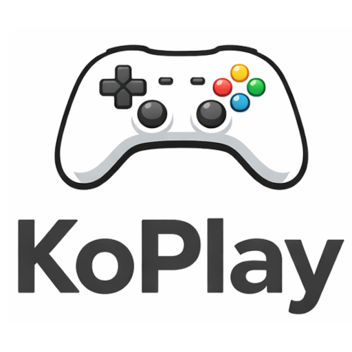

<div align="center">
  
  <h1>KoPlay</h1>
  <p><strong>JackBox-style party games for a shared screen + phone controllers</strong></p>

  
  
  
  
  
  
  
</div>

---

## Overview

KoPlay is a JackBox-style party game system. Any monitor with a web browser shows the game and a QR code; players join from their phones. Games: **Gorillas** (artillery), **Acrophobia** (invent funny acronyms, vote for the best) and **Trivia** (saved quizzes, optionally AI-generated).

## Quick start

Needs [Docker](https://docs.docker.com/get-docker/) on Linux or macOS (Windows: use WSL).

```bash
git clone https://github.com/alexanderbailey/tv_games.git
cd tv_games
./setup.sh
```

`setup.sh` asks a few questions (your name and the port), writes `.env.local`, prepares the Docker images, then offers to launch. AI quiz generation is optional: add `GEMINI_API_KEY=...` to `.env.local` to enable it. Next time just run `./start.sh` (or `npm run play`).

Launching starts the app plus a [Cloudflare quick tunnel](https://developers.cloudflare.com/cloudflare-one/connections/connect-networks/do-more-with-tunnels/trycloudflare/) (no account needed), opens the display on its public URL and prints the link for phones, which can be on any network. Phones scan the QR code (or enter the 5-letter game code shown on the screen) and type a name; the first to join becomes host. There are no passwords in local play. Ctrl+C stops everything. The tunnel only serves the game itself: the upload API is refused through it and is available only on `localhost`. Anyone with the tunnel URL and a live game code can join, and the first to join hosts.

## Other ways to run

```bash
docker compose up --build      # server on :3000 (see docker-compose.yml)
npm run build && npm start     # without Docker, Node 18+ (run npm install in . and client/ first)
npm run dev:server             # development: + npm run dev:client for Vite HMR on :5173
```

Display: `/screen` (log in with an access code) or `/screen/<screen-id>`. Phones: `/`. The 5-letter game code on the display is per game; access codes are server passwords set in `USERS`.

## Configuration

Set in `.env` (see `.env.example`); `setup.sh` writes its own `.env.local` for local play.

| Variable | Description |
|----------|-------------|
| `USERS` | Access codes and roles. See [docs/access-and-quizzes.md](docs/access-and-quizzes.md) |
| `SCREENS` | Pre-registered display IDs. Same doc |
| `GEMINI_API_KEY` | Optional. Enables AI quiz generation; without it only saved or uploaded quizzes are available |
| `GEMINI_MODEL` | Optional. Defaults to `gemini-2.5-flash` |
| `PORT` | Server port, default `3000` |
| `LOCAL_PORT` | Host port for local play (`.env.local`), default `4747` |

## More

- [Access, quizzes and the upload API](docs/access-and-quizzes.md)
- [Development: architecture and adding a game](docs/development.md)

## License

MIT
